<p align="center">
  
</p>

<p align="center">
  <a href="https://shumokh.dev">shumokh.dev</a> ·
  <a href="https://www.linkedin.com/in/shumokh-alsharif-903361364">linkedin</a> ·
  <a href="https://x.com/mukhaverse">x</a>
</p>

hey, i'm shumokh. i build for the web, mostly in the messy middle where frontend meets backend, and i care about how things feel as much as how they work.

```
~ $ now
  building   full-stack web apps
  learning   devops
  into       motion, interaction, three.js
```


<picture>
  <source media="(prefers-color-scheme: dark)" srcset="https://raw.githubusercontent.com/mukhaverse/mukhaverse/output/snake-dark.svg">
  
</picture>
